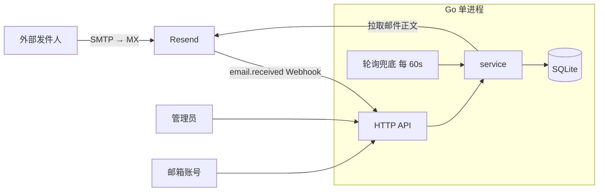

# xemail

基于 [Resend](https://resend.com) 的收信邮箱管理系统：管理员在后台创建邮箱账号，账号用随机密码登录网页查看收件箱。只收不发，不提供 IMAP / POP3 / SMTP。

## 工作方式



| 环节 | 说明 |
|---|---|
| 收信 | Webhook 到达立即同步；每 60 秒轮询兜底；管理员可手动同步 |
| 分发 | 按收件地址匹配账号；未匹配的邮件由管理员查看，之后创建同地址账号会自动归入 |
| 域名 | 管理员在后台维护收信域名白名单，创建账号时校验；白名单为空则不限制 |
| 登录 | 管理员用 `ADMIN_TOKEN`；账号用邮箱 + 一次性生成的随机密码 |
| 技术栈 | Go 标准库 `net/http` + SQLite（纯 Go）+ Vue 3 / Pinia / Tailwind，前端用 `go:embed` 打进单个二进制 |

## 快速开始

需要 Go 1.26+、pnpm。

```bash
cp .env.example .env     # 填入 RESEND_API_KEY 和 ADMIN_TOKEN
make dev-api             # 后端 :1980
make dev-web             # 前端热更新，/api 代理到 :1980
```

| 入口 | 地址 |
|---|---|
| 邮箱账号登录 | `/login` |
| 管理员登录 | `/admin/login` |

## 配置

读取项目根目录的 `.env`，已存在的环境变量优先。

| 变量 | 必填 | 默认 | 说明 |
|---|---|---|---|
| `RESEND_API_KEY` | 是 | — | Resend API Key |
| `ADMIN_TOKEN` | 是 | — | 管理员令牌，至少 16 位，建议 `openssl rand -hex 24` |
| `RESEND_WEBHOOK_SECRET` | 否 | — | Webhook 签名密钥（`whsec_…`）；不设置则不启用 Webhook，只靠轮询 |
| `XEMAIL_DOMAIN` | 否 | — | 仅用于初始化：启动时域名表为空才写入；之后以后台维护的域名为准 |
| `XEMAIL_ADDR` | 否 | `:1980` | 监听地址 |
| `XEMAIL_DB_PATH` | 否 | `data/xemail.db` | SQLite 文件 |

`.env` 含真实密钥，已被 `.gitignore` 排除，只提交 `.env.example`。

## 接入 Resend

| 步骤 | 操作 |
|---|---|
| 1 | Resend 添加收信域名，按提示配置 DNS 并开启 Receiving（MX 记录）；根域名已有 MX 时改用子域名，避免覆盖原有邮件 |
| 2 | Webhooks 页添加 `https://<你的域名>/api/webhooks/resend`，只订阅 `email.received` |
| 3 | 把返回的签名密钥写入 `RESEND_WEBHOOK_SECRET` 并重启 |
| 4 | 后台「域名管理」添加该域名，再在「账号管理」创建账号 |

Webhook 回调要求公网 HTTPS，反向代理必须原样转发请求体和 `svix-id`、`svix-timestamp`、`svix-signature` 三个请求头，并设置 `X-Real-IP`、`X-Forwarded-Proto`（后端据此取客户端 IP、判断 Secure Cookie）。

## 构建与测试

```bash
make build                                   # 前端构建 + 后端编译 → bin/xemail
go test ./...                                # 后端测试
cd web && pnpm build                         # 前端类型检查 + 构建
```

迁移在进程启动时自动执行，无需手动操作。

## 目录

```
cmd/xemail/       入口
internal/
  config/         环境变量与 .env
  resendx/        Resend SDK 封装（含 Webhook 验签）
  auth/           随机密码、bcrypt、会话、登录限流
  handler/        HTTP 路由与编解码
  service/        账号、域名、收信同步与分发
  store/          SQLite 访问
  webhook/        Webhook 验签、去重、触发同步
  middleware/     会话鉴权、日志、recover
migrations/       按序号执行的 SQL 迁移
web/              Vue 前端
docs/design.md    完整设计：数据模型、API、安全策略、风险
```

## 文档

完整的数据模型、API 列表、密码与会话规则、风险边界见 [docs/design.md](docs/design.md)。
