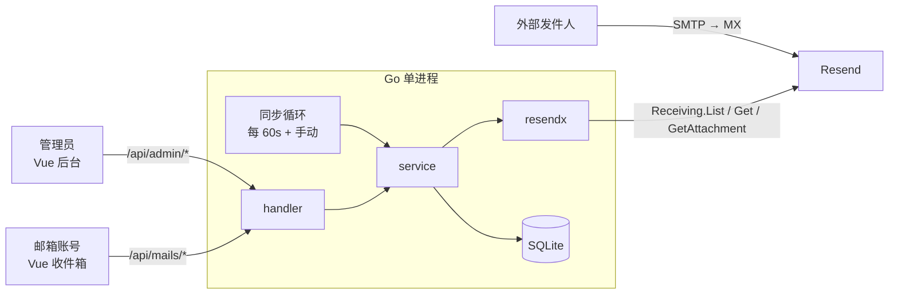
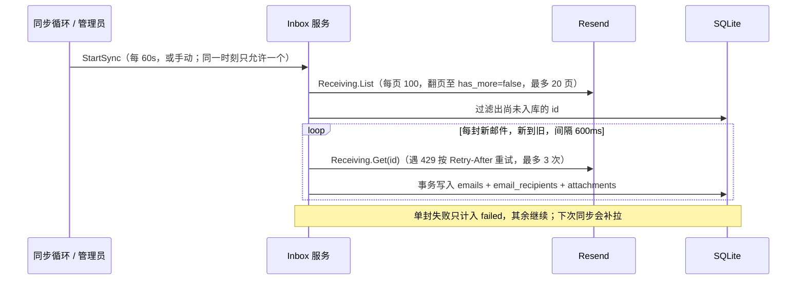

# xemail 方案：基于 Resend 的收信邮箱管理系统

> 一句话：Resend 负责收信，Resend 的 `email.received` Webhook 到达时立即触发同步，另有每分钟轮询兜底；Go 后端从 Resend Receiving API 拉取新邮件，按收件地址分发到后台配置的邮箱账号，账号用后台生成的随机密码登录网页查看；只收不发。

## 1. 范围

| 功能 | 状态 |
|---|---|
| 管理员后台：创建 / 禁用 / 删除邮箱账号，创建与重置时生成随机密码 | MVP |
| 收信：每分钟拉取 Resend 已收邮件 + 管理员手动同步 → 按收件地址分发 | MVP（已实现） |
| 收信：Resend `email.received` Webhook 实时推送 | M3b（已实现），需公网 HTTPS 回调地址与 `RESEND_WEBHOOK_SECRET` |
| 账号登录网页查看自己的收件箱、邮件详情、下载附件 | MVP |
| 未匹配任何账号的邮件，管理员可查看 | MVP |
| 发信、回复、转发、草稿 | 不做 |
| IMAP / POP3 / SMTP 对外服务 | 不做（需要自建邮件服务器，与使用 Resend 的前提冲突） |
| 管理员后台：增删收信域名（白名单），创建账号时按白名单校验 | MVP |
| 多管理员、邮件搜索、垃圾过滤 | 后续 |

## 2. 角色与权限

| 角色 | 登录方式 | 可做什么 |
|---|---|---|
| 管理员 | `ADMIN_TOKEN`（环境变量） | 账号增删改、重置密码、域名增删、查看未匹配邮件、手动同步 |
| 邮箱账号 | 邮箱地址 + 随机密码 | 只能看分发给自己的邮件 |

## 3. 架构



| 决策 | 选择 | 理由 |
|---|---|---|
| HTTP 路由 | 标准库 `net/http` | 路由少，零依赖 |
| Resend 调用 | 官方 `resend-go/v4`，仅在 `internal/resendx` 引用 | 业务层可 mock |
| 存储 | SQLite（`modernc.org/sqlite`，纯 Go） | 单文件部署；邮件与账号需要本地检索 |
| 密码哈希 | `golang.org/x/crypto/bcrypt`，cost 12 | 随机 16 位密码不超过 bcrypt 72 字节限制 |
| 会话 | 随机 token + DB 存哈希 + HttpOnly Cookie | 可服务端吊销（禁用账号、重置密码时立即失效） |
| 前端部署 | `go:embed` 嵌入 `web/dist` | 单二进制 |

## 4. 目录结构

```
xemail/
├── cmd/xemail/main.go
├── internal/
│   ├── config/        环境变量与 .env
│   ├── resendx/       Resend SDK 封装
│   ├── auth/          随机密码生成、bcrypt、会话、登录限流
│   ├── handler/       HTTP 路由与编解码
│   ├── service/       账号管理、收信分发
│   ├── store/         SQLite 访问
│   ├── webhook/       验签、幂等、事件分发（M3b，尚未实现）
│   └── middleware/    会话鉴权（admin / user）、日志、recover
├── migrations/        *.sql 按序号执行
├── web/
│   ├── embed.go
│   └── src/{api,components,views,stores,router}
├── docs/design.md
└── Makefile / .env.example
```

依赖方向：`handler → service → (resendx, store, auth)`；`webhook → service`。

## 5. 数据模型

| 表 | 字段 | 说明 |
|---|---|---|
| `accounts` | `id`, `address`(小写，唯一), `password_hash`, `enabled`, `note`, `created_at`, `password_updated_at`, `last_login_at` | 明文密码不落库 |
| `domains` | `name`(小写，PK), `created_at` | 收信域名白名单；表为空表示不限制 |
| `sessions` | `token_hash`(PK), `role`(`admin`/`user`), `account_id`(admin 为空), `expires_at` | 只存 token 的 SHA-256 |
| `emails` | `id`(Resend email id, PK), `from_addr`, `to_addrs`(JSON), `cc_addrs`(JSON), `subject`, `html`, `text`, `message_id`, `received_at` | 邮件内容只存一份，`id` 主键保证重复同步不重复入库 |
| `email_recipients` | `email_id`, `address`；PK(`email_id`,`address`) | 归一化后的全部收件地址（`received_for` ∪ `to` ∪ `cc` ∪ `bcc`，小写、去显示名） |
| `attachments` | `id`, `email_id`, `filename`, `content_type`；PK(`email_id`,`id`) | 仅元数据，下载时实时向 Resend 取临时 `download_url` |
| `mail_reads` | `account_id`, `email_id`；PK(`account_id`,`email_id`) | 已读状态，按账号隔离；一封邮件发给多个账号时各自独立 |
| `webhook_events` | `svix_id`(PK), `type`, `received_at` | 已处理的 `email.received` 事件，用于重放去重 |
| `login_attempts` | `key`(`ip|address`), `failed_count`, `locked_until`, `last_attempt_at` | 登录限流；管理员登录的 key 为 `ip|admin` |

邮件归属在查询时动态计算，不预先写"投递"记录：

| 概念 | 判定 |
|---|---|
| 账号的邮件 | 任一 `email_recipients.address` 等于该账号的 `address` |
| 未匹配邮件 | 没有任何收件地址对应已存在的账号（含已禁用账号） |

好处：账号晚于邮件创建时，历史邮件自动出现在该账号收件箱；删除账号后邮件回到"未匹配"，不会丢失。

## 6. 随机密码规则

| 项 | 规则 |
|---|---|
| 生成 | `crypto/rand`，16 位，字符集 `A-Z a-z 2-9` 去掉易混淆的 `I l O o 0 1` |
| 展示 | 仅在创建、重置的响应里返回一次明文，前端弹窗提示"关闭后无法再查看" |
| 存储 | bcrypt 哈希；明文不写日志、不落库 |
| 重置 | 生成新密码，更新 `password_updated_at`，删除该账号全部 `sessions` |
| 禁用 / 删除 | 同样立即删除该账号全部 `sessions` |
| 登录失败 | 账号不存在与密码错误返回同一错误；不存在时也执行一次 bcrypt 比对，避免时间差泄露账号是否存在 |
| 限流 | 同一 `IP + 地址` 的尝试按"间隔不超过 15 分钟"连续累计，累计 5 次即锁定 15 分钟，连续 15 分钟无尝试才清零；这比固定窗口更严，零散的慢速爆破同样会触发锁定；验证密码前先原子占用名额（并发请求无法绕过上限）；锁定期内正确密码也返回 429；登录成功清零 |
| 并发一致性 | 登录在 bcrypt 校验之后建会话，建会话的事务内复核账号仍启用且密码哈希未变；重置 / 禁用与登录交错时不会漏出有效会话 |
| 会话 | user 7 天，admin 12 小时；Cookie `HttpOnly` + `SameSite=Lax`，HTTPS 下加 `Secure` |

## 7. 后端 API

| 方法 | 路径 | 权限 | 说明 |
|---|---|---|---|
| GET | `/api/healthz` | 无 | 存活探针（已实现） |
| POST | `/api/auth/login` | 无 | `{address, password}`，建立 user 会话 |
| POST | `/api/auth/admin-login` | 无 | `{token}`，建立 admin 会话 |
| POST | `/api/auth/logout` | 无（幂等） | 删除当前会话并清除 Cookie，无会话时同样返回 204 |
| GET | `/api/me` | 会话 | 当前角色与地址 |
| GET | `/api/mails?limit=&offset=` | user | 自己的邮件，新到旧，`limit` 默认 50、最大 100，含 `is_read` 与 `total`；admin 访问返回 403 |
| GET | `/api/mails/{id}` | user | 详情，并标记已读；非本人邮件返回 404 |
| GET | `/api/mails/{id}/attachments/{aid}` | user | 校验归属后 302 到 Resend 临时地址（仅接受 https，`no-store`，`no-referrer`） |
| GET | `/api/admin/accounts` | admin | 账号列表 |
| POST | `/api/admin/accounts` | admin | `{address, note}`，返回账号与一次性明文密码 |
| POST | `/api/admin/accounts/{id}/reset-password` | admin | 返回新的一次性明文密码 |
| PATCH | `/api/admin/accounts/{id}` | admin | 修改 `enabled` / `note` |
| DELETE | `/api/admin/accounts/{id}` | admin | 删除账号及其会话、已读记录；邮件保留并回到未匹配 |
| GET | `/api/admin/domains` | admin | 域名列表，含各域名下的账号数 `accounts` |
| POST | `/api/admin/domains` | admin | `{name}`，自动转小写、去掉前导 `@`；格式错误 400，重复 409 |
| DELETE | `/api/admin/domains/{name}` | admin | 域名下仍有账号返回 409，不存在返回 404 |
| GET | `/api/admin/mails/unrouted?limit=&offset=` | admin | 未匹配邮件列表 |
| GET | `/api/admin/mails/unrouted/{id}` | admin | 未匹配邮件详情；已分发给账号的邮件返回 404，管理员不能借此读取用户邮件 |
| GET | `/api/admin/mails/unrouted/{id}/attachments/{aid}` | admin | 同上，仅限未匹配邮件的附件 |
| POST | `/api/admin/sync` | admin | 后台启动一次同步，202；已有同步进行中返回 409 |
| GET | `/api/admin/sync` | admin | 同步状态：`running`、`last_finished_at`、`listed`、`fetched`、`failed`、`last_error` |
| POST | `/api/webhooks/resend` | 签名 | 验签（Svix，含 5 分钟时间窗）→ 非 `email.received` 直接 200 → 按 `svix-id` 去重 → 触发同步；验签失败 400；未配置密钥时不注册该路由（404） |

## 8. 收信流程



设计要点：

| 要点 | 做法 |
|---|---|
| 不会漏旧邮件 | 每次都列出全部 id 再与库比对，不因"遇到已存在的就停"漏掉此前失败的旧邮件 |
| 幂等 | `emails.id` 主键 + `INSERT OR IGNORE`，重复同步不产生重复邮件 |
| 限流 | 请求间隔 600ms；遇 `RateLimitError` 按 `Retry-After` 重试 |
| 并发 | 同一时刻只有一个同步；重复触发返回 409 |
| 收件人 | 用 Resend 的 `received_for`（实际投递地址，含 Bcc）并上 `to` / `cc` / `bcc`，所以 Bcc 收件人也能分发 |

匹配规则：

| 情况 | 处理 |
|---|---|
| 收件地址命中一个或多个账号（含显示名写法 `Name <a@b.com>`，不区分大小写） | 每个账号的收件箱都能看到 |
| 命中账号但账号已禁用 | 账号无法登录；邮件仍归该账号，不进入"未匹配" |
| 没有命中任何账号 | 管理员在"未匹配邮件"里查看；之后创建同地址账号即自动归入 |

> Webhook：`email.received` 只带元数据，到达后只触发一次同步，复用上面的同步逻辑。同步进行中收到事件时，该同步可能已列完邮件、漏掉新邮件，所以 `Inbox.Trigger` 记下标记，本轮结束后立刻再同步一次。验签用原始 body。进程在"记录事件"与"同步"之间崩溃时，由 60 秒轮询补上。

## 9. 前端

| 路由 | 视图 | 角色 | 内容 |
|---|---|---|---|
| `/login` | LoginView | 无 | 邮箱账号登录；页面上不出现任何管理员入口 |
| `/admin/login` | LoginView（`meta.admin`） | 无 | 管理员令牌登录；`/admin` 会跳到 `/admin/accounts`，未登录再跳到这里 |
| `/inbox` | InboxView | user | 邮件列表、未读标记、详情、附件 |
| `/admin/accounts` | AccountsView | admin | 账号表格；新建、重置密码、启用 / 禁用、删除；一次性密码弹窗带复制按钮 |
| `/admin/domains` | DomainsView | admin | 域名表格；添加、删除（有账号的域名不可删） |
| `/admin/unrouted` | UnroutedView | admin | 未匹配邮件列表 |

约定：

- 请求统一走 `web/src/api/client.ts`，收到 401 跳 `/login`。
- 路由守卫按 `/api/me` 的角色放行；user 访问 `/admin/*` 跳回 `/inbox`。
- 未登录时按路径区分登录页：`/admin/*` 跳 `/admin/login`，其余跳 `/login`；会话过期和退出登录同理，回到各自的入口。
- 管理员入口只靠路径区分，不算安全边界：`/api/auth/admin-login` 仍有令牌校验和限流。
- HTML 邮件正文放在 `sandbox` 的 `iframe`（不加 `allow-scripts`）里渲染，防止邮件内脚本执行。
- 只用 Tailwind 工具类，不写 `<style>` 块。

## 10. 配置

| 变量 | 必填 | 默认 | 说明 |
|---|---|---|---|
| `RESEND_API_KEY` | 是 | — | 同时兼容当前 `.env` 的 `resend_key` |
| `RESEND_WEBHOOK_SECRET` | 否 | — | Resend Webhook 的签名密钥（`whsec_…`）；不设置则不启用 Webhook，只靠轮询 |
| `ADMIN_TOKEN` | 是（M1 起） | — | 管理员登录令牌，至少 16 位，建议 `openssl rand -hex 24` |
| `XEMAIL_DOMAIN` | 否 | — | 仅用于初始化：启动时若 `domains` 表为空则写入该域名（兼容 `.env` 里的 `domain`）；之后以后台维护的域名为准 |
| `XEMAIL_ADDR` | 否 | `:1980` | 监听地址 |
| `XEMAIL_DB_PATH` | 否 | `data/xemail.db` | SQLite 文件 |

## 11. 里程碑与验收

| # | 任务 | 验收标准 |
|---|---|---|
| M0 | 项目骨架（已完成） | `go build`、`pnpm build` 通过；`/api/healthz` 返回 ok；前端路由可切换 |
| M1 | 存储 + 认证：迁移、会话、两种登录、登录限流 | 迁移可重复执行；错误密码与不存在账号返回相同响应；连续失败 5 次后第 6 次即使密码正确也被拒；无会话访问 `/api/me`、`/api/admin/accounts` 返回 401（`/api/mails` 随 M4 实现后纳入） |
| M2 | 账号管理：增删改、随机密码、重置 | 创建返回的明文密码能登录且只返回一次；数据库中无明文；重置后旧密码和旧会话立即失效；禁用账号无法登录 |
| M3 | 收信：拉取同步、幂等、按收件地址分发（已完成） | 重复同步不产生重复邮件；单封拉取失败不影响其余，下次能补回；发给两个账号的邮件两边都能看到；Bcc 与 `Name <addr>` 写法能匹配；发给未配置地址的邮件出现在"未匹配"，创建同地址账号后自动归入 |
| M4 | 用户收件箱：列表、详情、附件、手动同步（已完成） | 账号 A 请求账号 B 的邮件 id 返回 404；附件跳转仅限本人邮件且仅 https；管理员读不到已分发邮件；打开邮件后标记已读 |
| M3b | Webhook 实时推送（已完成） | 伪造签名返回 400；同一 `svix-id` 重放不重复触发；真实邮件到达后无需等待 60s 轮询即可出现 |

## 12. 风险与边界

| 风险 | 影响 | 应对 |
|---|---|---|
| 域名未按 Resend 收信要求配置 MX | 收不到任何邮件 | 已验证当前账号能收到邮件；换域名或换 Resend 账号时需重新配置 |
| 新邮件最多延迟 60 秒 | 未装 Webhook 时不是实时 | 管理员可手动"立即同步"；M3b 接入 Webhook 后消除 |
| 同步需逐封拉取正文 | 邮件很多时首次同步耗时长（每封约 0.6s） | 后台执行，页面显示进度；已入库的不会重复拉取 |
| 单次同步最多列出 2000 封 | 超出部分本次不会入库 | 个人 / 小团队量级足够；后续可改为游标增量 |
| 附件下载地址是 Resend 的临时签名链接 | 过期后失效 | 每次点击实时向 Resend 申请新的，不落库 |
| Webhook 验签必须用原始 body | 先解析 JSON 会导致验签失败 | handler 先 `io.ReadAll`，验签通过再反序列化 |
| Webhook 重复或乱序 | 重复触发同步 | `svix_id` 主键去重；同步本身幂等 |
| 回调地址不可达（未部署、HTTPS 证书、反向代理未转发 `svix-*` 头） | Resend 重试后放弃，邮件延迟最多 60 秒 | 轮询兜底；在 Resend 的 Webhooks 页查看事件投递状态并可重放 |
| 邮件 HTML 含恶意脚本 / 追踪图片 | XSS、泄露阅读行为 | `sandbox` iframe 不放开脚本；后续可加外链图片默认屏蔽 |
| 一次性密码被截图 / 转发 | 账号被盗用 | 重置接口随时可用；登录限流；管理员应通过安全渠道发给使用者 |
| 单一 `ADMIN_TOKEN` | 泄露即全权限，无操作审计 | MVP 接受；要求随机长串、仅放 `.env`；多管理员与审计放后续 |
| API Key 泄露 | 他人读取你的收件数据 | 仅放 `.env` 且已 gitignore；日志不得打印 |
| SQLite 单写 | 高并发写入受限 | 个人 / 小团队量级足够；`store` 层已隔离，可换 PostgreSQL |

## 13. 本地启动

```bash
make dev-api   # 后端 :1980，自动读取 .env
make dev-web   # 前端热更新，/api 代理到 :1980
make build     # 单二进制 bin/xemail
```
